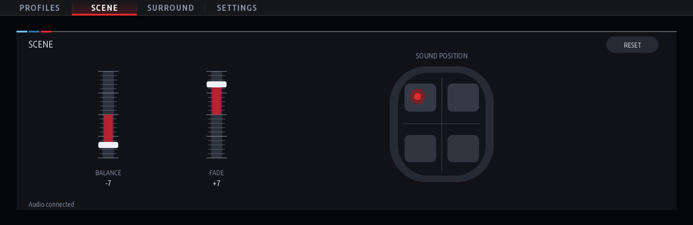
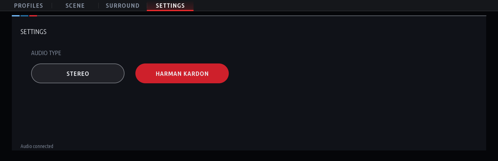

# EQ Config

EQ Config is an audio configuration app for BMW iDrive 7 / MGU. It provides editable sound profiles, a visual sound-stage control, and a surround switch. Use the touchscreen or the iDrive controller.

> **Compatibility:** Tested on iDrive 7 (ID7) with Harman Kardon audio. Other audio systems, vehicles, and MGU software versions have not been verified. Audio property mappings may differ between configurations.

## Screenshots

### Profiles

Choose a profile to apply it immediately. The active profile has a check mark. Adjust the frequency bars to apply and save changes; **Reset** restores the original profile. Three custom slots are available.

### Scene

Adjust balance and fade while the dot shows the sound position in the cabin. Changes apply immediately; **Reset** returns the scene to the center.

### Surround

Turn surround sound on or off. A surround level slider is not yet available.

### Settings

Select **Stereo** or **Harman Kardon** as the audio type. Stereo shows Scene and Settings; Harman Kardon also shows Profiles and Surround.

The Scene screen in Stereo mode:

## Install with MGU Store

1. Install and open [MGU Store](https://github.com/robertnisipeanu/mgu-store) on the head unit.
2. In MGU Store, open **Settings** → **Add source**.
3. Enter `timokhin/id7-eq-config` and confirm.
4. Select the **Releases** channel when prompted.
5. Open **Store**, select **EQ Config**, and choose **Install**. If it is already installed, choose **Update**.

MGU Store requires a connection to fetch the GitHub release. For full-screen touch interaction, the head unit needs a compatible MGU renderer; controller input also requires a controller gate.

### Install from USB

With MGU Store already installed, connect a USB stick prepared as an MGU Store source, open **USB** in the Store, select **EQ Config**, and choose **Install** or **Update**. See the [MGU Store documentation](https://github.com/robertnisipeanu/mgu-store#offline-usb-stick) for preparing a USB source.

## Controls

On the iDrive controller, move focus to a slider and press the controller to enter edit mode. Turn it to change the value, then press again to finish. You can also adjust sliders using the touchscreen.

The app reads available audio properties and verifies written values. If a write fails, it attempts to restore the previous values. The currently used mappings were observed on one vehicle: `sink:1` Bass = 2, Treble = 3, Balance = 4, Fade = 5, EQ bands = 6–12, and Surround = 14. Negative Balance moves the scene left; positive Fade moves it forward. The controls use a −10 to +10 scale.

## Build

Run `python3 tools/build_release.py` to build an installable package in `dist/`. The package does not include BMW's proprietary SDK. See [THIRD_PARTY_NOTICES.md](THIRD_PARTY_NOTICES.md) for third-party license information.
